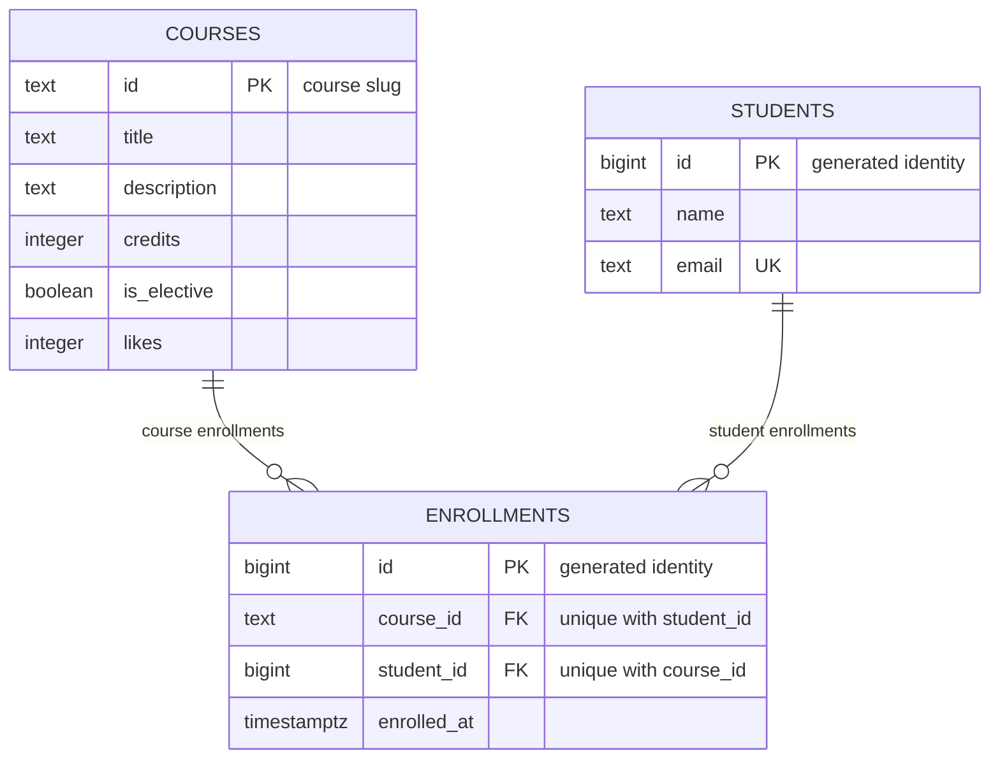

# course-catalog-db

PostgreSQL schema for Course Catalog, Lab 6 of Advanced Web Technologies.
Author: Timur Murat. The frontend and FastAPI projects are unchanged.

## How to run

Requires PostgreSQL 16+ and the psql client. Once, as the postgres superuser:

```sql
CREATE ROLE catalog_app LOGIN PASSWORD 'change-me';
CREATE DATABASE course_catalog OWNER catalog_app;
CREATE DATABASE idx_demo OWNER catalog_app;
CREATE DATABASE norm_demo OWNER catalog_app;
```

From this repository, run the following commands. Enter the teaching password
`change-me` when prompted. On Windows, first set `$env:PGCLIENTENCODING = "UTF8"`.
Port 5432 is the default; add `-p YOUR_PORT` to each command if needed.

```bash
psql -h localhost -U catalog_app -d course_catalog -v ON_ERROR_STOP=1 -f schema.sql
psql -h localhost -U catalog_app -d course_catalog -v ON_ERROR_STOP=1 -f seed.sql
psql -h localhost -U catalog_app -d course_catalog -v ON_ERROR_STOP=1 -f queries.sql
```

`schema.sql` intentionally drops the three teaching tables: rebuilding erases
their contents and resets identity sequences. Run `seed.sql` once per rebuild.
Afterwards there are 6 courses, 3 students and 6 enrollments. Queries 3 and 4
roll back their writes. Identity sequences are not rolled back, so the example
enrollment ID can increase between runs while stored data stays the same.
The password above is a lab example; real credentials do not belong in Git.

## Constraint violation log

Executed against PostgreSQL 18, as `catalog_app`.
Complete statements and actual error messages: [evidence/constraints.txt](evidence/constraints.txt).
HTTP values below describe the intended API mapping; this lab changes SQL only.

| Experiment | SQLSTATE | Constraint or NOT NULL column | API response |
|---|---|---|---|
| NULL title | `23502` | `title` | 422 |
| Zero credits | `23514` | `courses_credits_check` | 422 |
| Negative likes | `23514` | `courses_likes_check` | 422 |
| Short name | `23514` | `students_name_check` | 422 |
| Duplicate email | `23505` | `students_email_key` | 409 |
| Duplicate course ID | `23505` | `courses_pkey` | 409 |
| Duplicate enrollment | `23505` | `enrollments_course_id_student_id_key` | 409 |
| Missing course | `23503` | `enrollments_course_id_fkey` | 404 |
| Missing student | `23503` | `enrollments_student_id_fkey` | 404 |
| Delete enrolled course | `23001` | `enrollments_course_id_fkey` | 409 |
| Delete student 1 | No error | `enrollments_student_id_fkey` with CASCADE | 204 |

For the cascade experiment, deleting student 1 removed both of that student's
enrollments; the course rows stayed. ROLLBACK restored the student and both
enrollments. A foreign-key failure on an INSERT means a referenced resource
does not exist (404); a restricted DELETE conflicts with existing enrollments
(409). NOT NULL and CHECK failures map to invalid input (422); duplicates map
to conflict (409). These are deliberate route-level choices, not HTTP responses
automatically produced by PostgreSQL.

Pydantic checks incoming API data and gives early feedback, but scripts, another
application or direct SQL can bypass the API. Database constraints protect every
write regardless of its source, including concurrent requests.

## Index: EXPLAIN before and after

In `idx_demo`, loaded 500 courses, 20,000 students and 50,000 enrollments.
Query: `SELECT * FROM enrollments WHERE student_id = 777;`.
Each timing is the minimum of three real EXPLAIN ANALYZE runs on this laptop.
All six runs and the other lookup plans are in [evidence/index.txt](evidence/index.txt).

| Measurement | Before index | After index |
|---|---|---|
| Access method | Seq Scan on enrollments | Bitmap Heap Scan on enrollments |
| Estimated cost | 0.00..1042.00 | 4.31..15.59 |
| Rows removed by filter | 49997 | 0 (no filter scan) |
| Execution time | 1.838 ms | 0.016 ms |

Before:

```text
Seq Scan on enrollments  (cost=0.00..1042.00 rows=3 width=34)
  Filter: (student_id = 777)
```

After:

```text
Bitmap Heap Scan on enrollments  (cost=4.31..15.59 rows=3 width=34)
  Recheck Cond: (student_id = 777)
  ->  Bitmap Index Scan on enrollments_student_id_idx  (cost=0.00..4.31 rows=3 width=0)
        Index Cond: (student_id = 777)
```

Table size: 3336 kB; added index size: 896 kB.

1. PRIMARY KEY and UNIQUE create indexes automatically; FOREIGN KEY does
   not create an index on its referencing column. The unique pair
   `(course_id, student_id)` serves searches by its leading `course_id` column;
   on this dataset it did not replace a dedicated student lookup index.
   Email lookup used `students_email_key`, and course lookup used
   `enrollments_course_id_student_id_key`.
2. Six course rows fit in a very small table. Sequential access costs less than
   going through an index. The student lookup otherwise scans 50,000 enrollment
   rows, so a selective index saves work. The planner chooses by estimated cost,
   not simply by whether an index exists.
3. The index speeds up listing a student's enrollments and finding their child
   rows when a student is deleted with CASCADE. It uses storage and makes writes
   maintain another index, so unnecessary indexes should be avoided.

Small main-table lookup after ANALYZE:

```text
Seq Scan on courses  (cost=0.00..1.07 rows=1 width=100)
  Filter: (id = 'api-design'::text)
```

To repeat the index experiment after the final schema includes the index:

```bash
psql -h localhost -U catalog_app -d idx_demo -v ON_ERROR_STOP=1 -f schema.sql
psql -h localhost -U catalog_app -d idx_demo -v ON_ERROR_STOP=1 -c "DROP INDEX enrollments_student_id_idx;"
psql -h localhost -U catalog_app -d idx_demo -v ON_ERROR_STOP=1 -f experiments/idx_data.sql
psql -h localhost -U catalog_app -d idx_demo
```

Then compare in psql:

```sql
EXPLAIN SELECT * FROM students WHERE email = 'student777@example.com';
EXPLAIN SELECT * FROM enrollments WHERE course_id = 'course-7';
EXPLAIN ANALYZE SELECT * FROM enrollments WHERE student_id = 777;
-- Run the previous statement three times; record the minimum Execution Time.
CREATE INDEX enrollments_student_id_idx ON enrollments(student_id);
EXPLAIN ANALYZE SELECT * FROM enrollments WHERE student_id = 777;
-- Repeat three times again. Execution times vary by machine and cache state.
```

## Transaction

Scenario: enroll Madina Ospanova in a course using two inserts. Tested with two
independent database connections, A (writer) and B (observer). Actual observations
are in [evidence/transaction.txt](evidence/transaction.txt).

- A began a transaction and inserted Madina. The second insert referenced
  `no-such-course`, failed with SQLSTATE 23503, and aborted the transaction.
  A subsequent SELECT failed with 25P02 (current transaction is aborted).
  After ROLLBACK, Madina's count was 0: the first insert was undone as well.
- In a new transaction A inserted Madina and enrolled her in `web-security`.
  B saw count 0 before COMMIT and count 1 after COMMIT. The final totals were
  4 students and 7 enrollments. Default isolation was `read committed`.
- Without a transaction, the first insert would commit independently. A failed
  second insert would leave a student without the intended enrollment.

To reproduce, start two psql sessions connected to `course_catalog`.
For the failure case, execute in A:

```sql
BEGIN;
INSERT INTO students(name,email) VALUES ('Madina Ospanova','madina@example.com');
INSERT INTO enrollments(course_id,student_id)
SELECT 'no-such-course',id FROM students WHERE email='madina@example.com';
SELECT count(*) FROM students; -- expected 25P02
ROLLBACK;
SELECT count(*) FROM students WHERE email='madina@example.com'; -- 0
```

For the successful case, begin and run both inserts in A, using `web-security`
instead of `no-such-course`. Before committing, run the last count query in B:
it returns 0. COMMIT in A, then repeat in B: it returns 1. Finally rebuild with
schema.sql and seed.sql to restore the 6/3/6 dataset. Keep transactions short:
they hold locks until committed or rolled back.

## Schema



Courses and students each have zero or many enrollments. Every enrollment
references exactly one existing course and student. Enrollments implement the
many-to-many relationship; UNIQUE(course_id, student_id) prevents duplicate pairs.

## Design decisions

- `courses.id` is a readable slug that matches the existing API URLs. It is
  longer than an integer and renaming a slug affects references. Student IDs are
  generated bigint values: compact, stable keys independent of names and email,
  but not meaningful to a human. Email is a separate unique business value.
- A course with enrollments is protected by RESTRICT to prevent removing a
  referenced catalog entry. CASCADE removes a deleted student's enrollments,
  which have no independent meaning without that student. Deleting a student
  never deletes the courses.
- `timestamptz` represents a real instant and displays it in the session time
  zone; `timestamp` alone has no time-zone context. `text` avoids arbitrary
  length limits; domain rules such as minimum name length belong in explicit
  CHECK constraints. PostgreSQL does not make varchar(n) inherently faster.

## Self-review against the checklist

| What to check | Result |
|---|---|
| Keys | Yes: all three tables have PKs; both enrollment relationships have FKs. |
| Types | Yes: text slugs, bigint identities, integer credits/likes, boolean elective flag and timestamptz enrollment time. |
| Required values | Yes: every domain column is NOT NULL; PK/identity columns are implicitly NOT NULL. |
| Constraints | Yes: credits > 0, likes >= 0, name length >= 2, unique email and enrollment pair. API validation should use these same domain rules. |
| Deletion | Yes: deliberate course RESTRICT and student CASCADE, both experimentally checked. |
| Normalization | Yes: course facts and student facts are stored once; enrollments reference keys and contain no lists. |
| Indexes and names | Yes: consistent snake_case; PK/UNIQUE indexes plus the measured student FK index. The course FK is covered by the leading column of the unique pair. |

## Validation and submission

Evidence files were generated by real runs, not copied from the assignment.
The lab was tested on a separate local PostgreSQL instance on port 55436, to
avoid changing existing laptop databases. The commands above use the standard
port; pass `-p 55436 -h 127.0.0.1` to use that local instance.

Final validation rebuilt schema and seed, ran queries.sql twice with
ON_ERROR_STOP=1, compared stored rows before and after, and checked counts 6/3/6.
The example enrollment IDs differ across runs because sequences do not roll back.
See [evidence/final-validation.txt](evidence/final-validation.txt).

Repository: https://github.com/MURXIV/course-catalog-db

Submit this repository URL through the instructor's required channel.

## Bonus

All five optional Lab 6 tasks were implemented and run. Results are real
PostgreSQL output in [evidence/bonus](evidence/bonus). Experiments use separate
databases `lab6_bonus`, `lab6_bonus_norm` and `lab6_bonus_email`. They never run
schema.sql on the `course_catalog` database now used by Lab 7.

### Run all five tasks

From this repository on the configured laptop:

```powershell
powershell -ExecutionPolicy Bypass -File .\run_bonus.ps1
```

This helper uses the sibling API project's Python environment. Independently,
install `psycopg[binary]`, then run `python run_bonus.py`. Default connection:
127.0.0.1:55436, application role catalog_app, admin role postgres. `--host`,
`--port`, `--user`, `--admin-user`, `--psql` can override these. The runner uses
psql/libpq authentication (for password authentication use PGPASSFILE). It
creates its named experiment databases if missing and rebuilds only their lab
tables. PostgreSQL must be running and the admin role must be able to create DBs.
The output of every task is saved; assertions fail the run if results differ.

### 1 Normalization

Code: [experiments/norm_demo.sql](experiments/norm_demo.sql) and
[experiments/normalization.sql](experiments/normalization.sql).
Result: [1-normalization.txt](evidence/bonus/1-normalization.txt).

The flat registrations table repeats student/course facts. Renaming just one
registration produced two titles for modern-frontend (update anomaly). Deleting
the only FastAPI registration removed all knowledge of that course (delete
anomaly). Adding a course with no enrollment required NULL student fields
(insert anomaly). Each test was rolled back. INSERT SELECT then split the flat
data into 3 courses, 3 students and 6 enrollments, preserving all six relations.
The three unrepresented courses cannot be recovered from the flat table.
Normalized tables store courses/students once and link them by keys; a course
can exist independently of its enrollments.

### 2 Lost update and row lock

Code: the two-connection experiment in [run_bonus.py](run_bonus.py).
Result: [2-lost-update-lock.txt](evidence/bonus/2-lost-update-lock.txt).

Both sessions read 11. Both wrote the computed value 12, losing one like.
Two `SET likes = likes + 1` commands returned 12 then 13. In a real concurrent
run, `pg_blocking_pids` confirmed that B waited for A's lock; after A committed,
B resumed and returned 13. PostgreSQL applies the expression to the current row
after obtaining its lock. Likes were restored to 11 afterwards.

For a live two-window demonstration, open two psql sessions connected to
`lab6_bonus` on the same host/port, then follow this order:

```sql
SELECT likes FROM courses WHERE id = 'api-design';
```

Run that in A and B (both 11), then in each window:

```sql
UPDATE courses SET likes = 12 WHERE id = 'api-design';
```

The final value is 12. Reset to 11 in A, then show the lock:

```sql
UPDATE courses SET likes = 11 WHERE id = 'api-design';
BEGIN;
UPDATE courses SET likes = likes + 1 WHERE id = 'api-design' RETURNING likes;
```

In B:

```sql
UPDATE courses SET likes = likes + 1 WHERE id = 'api-design' RETURNING likes;
```

B waits. In A run `COMMIT;`: B returns 13. Finally reset to 11 in either window.
The BEGIN/update portion is also [lock_a.sql](experiments/lock_a.sql); B's update
is [lock_b.sql](experiments/lock_b.sql). Run these in interactive psql sessions;
a standalone psql -f that exits would roll back the open transaction in A.

### 3 SQL injection and parameters

Code: [experiments/sql_injection.sql](experiments/sql_injection.sql).
Result: [3-sql-injection.txt](evidence/bonus/3-sql-injection.txt).

The concatenation example `WHERE id = 'x' OR '1'='1'` returned all 6 courses.
PREPARE keeps `$1` as a value, separate from SQL syntax: the exact attack string
returned 0 rows, while api-design returned 1. Quotes and OR in a parameter are
data, not executable parts of the condition. The prepared statement was freed
with DEALLOCATE afterwards.

### 4 Courses without enrollments and HAVING

The two queries are appended to [queries.sql](queries.sql); a short standalone
version is [experiments/bonus_queries.sql](experiments/bonus_queries.sql).
Result: [4-extra-queries.txt](evidence/bonus/4-extra-queries.txt).

LEFT JOIN plus `e.id IS NULL` returned api-design, databases-postgresql and
web-security, alphabetically. GROUP BY plus `HAVING count(*) > 1` returned
Daniyar Bekov with 3 courses and Aigerim Sadykova with 2. WHERE filters rows
before grouping; HAVING filters the resulting groups. The full queries.sql was
also run twice and all stored rows remained unchanged.

### 5 ALTER TABLE email rule

Code: [experiments/email_rule.sql](experiments/email_rule.sql).
Result: [5-alter-email.txt](evidence/bonus/5-alter-email.txt).

On a populated copy of the old schema, ALTER TABLE added the named CHECK
`students_email_format` using `position('@' IN email) > 1`. The invalid address
no-at-sign was rejected with SQLSTATE 23514; all 3 existing students remained.
This rule is also in the final schema.sql, so rebuilding produces the same rule.
It checks only the lab's @ condition, not every rule of email syntax.
The test script temporarily allows its one expected SQL error and then restores
ON_ERROR_STOP. The main API database was left unchanged.

Historical mandatory-task evidence above predates this optional CHECK; the
additional constraint is intentional. Do not replace Lab 7's database schema
with this Lab 6 teaching schema. See [BONUS_DEFENSE_RU.md](BONUS_DEFENSE_RU.md)
for the short demonstration order in Russian.
